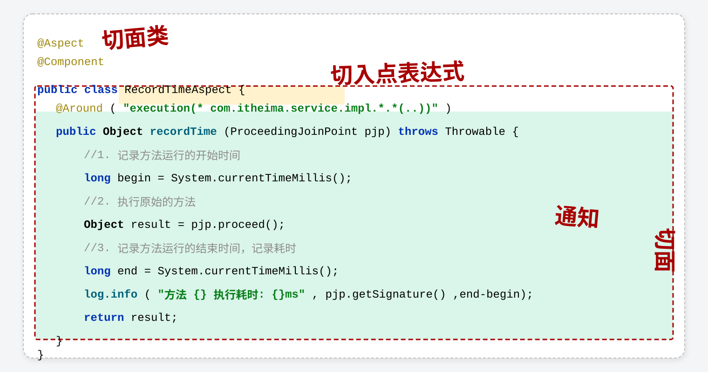
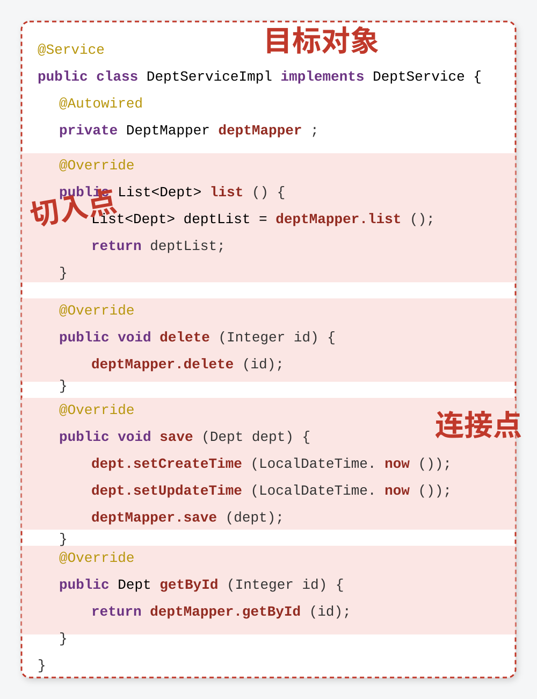

AOP: Aspect Oriented Programming (面向切面编程、面向方法编程)
	可简单理解为是面向特定方法编程。

场景: 案例中部分业务方法运行较慢，定位执行耗时较长的接口，此时需要统计每个业务的执行耗时。

优势:
1. 减少重复代码
2. 代码无侵入
3. 提高开发效率
4. 维护方便

> [!tip]
> AOP 是一种思想，而在 Spring 框架中对这种思想进行了实现。
> 
> 以下为 Spring AOP。

# AOP 基础

## 快速入门

需求: 统计所有业务层方法的执行耗时

1. 导入依赖: 在 `pom.xml` 中引入 AOP 的依赖
   ```xml
   <dependency>  
    <groupId>org.springframework.boot</groupId>  
    <artifactId>spring-boot-starter-aop</artifactId>  
    <version>3.2.8</version>
	</dependency>
   ```
2. 编写 AOP 程序: 针对特定的方法根据业务需要进行编程
```java
@Slf4j // 日志
@Aspect // 标识当前是 AOP 类  
@Component // 将类交给 IOC 容器管理
public class RecordTimeAspect {  
  
    @Around("execution(* com.itheima.service.impl.*.*(..))")  
    public Object recordTime(ProceedingJoinPoint pjp) throws Throwable {  
        // 1. 记录方法运行的开始时间  
        long begin = System.currentTimeMillis();  
  
        // 2. 执行原始方法  
        Object result = pjp.proceed();  
  
        // 3. 记录方法运行的结束时间，记录耗时  
        long end = System.currentTimeMillis();  
        log.info("方法 {} 执行耗时: {}ms", pjp.getSignature(), end - begin);  
  
        return result;  
    }  
}
```

## 核心概念

- **连接点**: JoinPoint，*可以被 AOP 控制*的方法(含方法执行时的相关信息)
- **通知**: Advice，值哪些重复的逻辑，即共性功能(最终体现为一个 AOP 方法)
- **切入点**: PointCut，匹配连接点的条件，通知仅会在切入点方法执行时被应用(*实际被 AOP 控制*的方法)
  切入点一定是连接点，但连接点不一定是切入点。
- **切面**: Aspect，描述通知与切入点的对应关系(通知 + 切入点) 
- **目标对象**: Target，通知所应用的对象





## 执行流程

AOP 底层通过 **动态代理** 实现。

```java
@Slf4j // 日志
@Aspect // 标识当前是 AOP 类  
@Component // 将类交给 IOC 容器管理
public class RecordTimeAspect {  
  
    @Around("execution(* com.itheima.service.impl.*.*(..))")  
    public Object recordTime(ProceedingJoinPoint pjp) throws Throwable {  
        // 1. 记录方法运行的开始时间  
        long begin = System.currentTimeMillis();  
  
        // 2. 执行原始方法  
        Object result = pjp.proceed();  
  
        // 3. 记录方法运行的结束时间，记录耗时  
        long end = System.currentTimeMillis();  
        log.info("方法 {} 执行耗时: {}ms", pjp.getSignature(), end - begin);  
  
        return result;  
    }  
}
```

假设目标对象为如下对象：

```java
@Slf4j  
@Service  
public class DeptServiceImpl implements DeptService {  
    @Autowired  
    private DeptMapper deptMapper;
    
	@Override  
	public Dept getById(Integer id) {  
	    Dept dept = deptMapper.getById(id);  
	    return dept;  
	}
}
```

AOP 会生成生成如下代理对象:

```java
public class DeptServiceProxy implements DeptService {  

	@Override  
	public Dept getById(Integer id) {  
		long begin = System.currentTimeMillis();  
	
	    Dept dept = 目标对象.getById(id);  // 伪代码
	
		long end = System.currentTimeMillis();  
        log.info("方法 {} 执行耗时: {}ms", pjp.getSignature(), end - begin);
	    return dept;  
	}
}
```

并将该代理对象交由 IOC 容器管理，当存在方法需要注入 `DeptService` 接口的实现类时，IOC 容器就会将该代理对象进行注入，从而达到需求的实现。

# AOP 进阶

## 通知类型

- `@Around`: 环绕通知，此注解标注的通知方法在目标方法前、后都被执行
- `@Before`: 前置通知，此注解标注的通知方法在目标方法前被执行
- `@After`: 后置通知，此注解标注的通知方法在目标方法后被执行，无论是否有异常都会执行
- `@AfterReturning`: 返回后通知，此注解人标注的通知方法在目标方法后被执行，有异常不会执行
- `@AfterThrowing`: 异常后通知，此注解标注的通知方法异常后执行

> [!warning] 注意
> 1. `@Around` 环绕通知需要自己调用 `ProceedingJoinPoint.proceed()` 来让原始方法执行，其他通知不需要考虑。
> 2. `@Around` 环绕通知方法的返回值，必须指定为 `Object`，来接收原始方法的返回值。
>    原始方法的返回值多种多样。

## @PointCut 设置公共切入点表达式

该注解的作用是将公共的切点表达式抽取出来，需要用到时引用该切入点表达式即可。

```java
@Pointcut("execution(* com.itheima.service.impl.DeptServiceImpl.*(..))")
public void pt(){}

@Around("pt()")
public Object recordTime(ProceedingJoinPoint joinpoint) throws Throwable{
```

> [!note] `@pointcur` 的修饰符选择
> `public` 在其他外部的切面类中也可以引入该表达式。
> 
> `private` 仅能在当前切面类中引用该表达式。

## 通知顺序

当有多个切面的切入点都匹配到了目标方法，目标方法运行时，多个通知方法都会被执行。

执行顺序: 
- 不同切面类中，默认按照切面类的 *类名字母排序*:
	- 目标方法前的通知方法: 字母排名越靠前的 先执行。
	- 目标方法后的通知方法: 字母排名越靠前的 后执行。
- 用 `@Order(数字)` 加在切面类上来控制顺序
	- 目标方法前的通知方法: 数字越小的 先执行。
	- 目标方法后的通知方法: 数字越小的 后执行。

## 切入点表达式

介绍: 描述切入点方法的一种表达式。

作用: 用来决定项目中的哪些方法需要加入通知。

常见形式:
1. `execution(...)`: 根据方法的签名来匹配
   ```java
   @Before("execution(public void com.itheima.service.impl.DeptServiceImpl.delete(java.lang.Integer))")
   public void before(JoinPoint joinPoint){}
   ```
2. `@annotation(...)`: 根据注解匹配
   ```java
   @Before("@annotation(com.itheima.anno.Log)")
   public void before(){}
   ```

### execution()

```java
@Before("execution(public void com.itheima.service.impl.DeptServiceImpl.delete(java.lang.Integer))")
public void before(JoinPoint joinPoint){}
```

execution 主要根据方法的返回值、包名、类名、方法名、方法参数等信息来匹配，语法为:

```
execution(访问修饰符? 返回值 包名.类名.?方法名(方法参数) throws 异常?)
```

其中带 `?` 的表示可以省略的部分
1. `访问修饰符`: 可省略(比如 public、protected)
2. `包名.类名`: 可省略(强烈不建议省略)
3. `throws 异常`: 可省略
   注意是方法上声明抛出的异常，不是实际抛出的异常

可以使用通配符描述切入点
1. `*`: 单个独立的任意符号，可以通配任意返回值、包名、类名、方法名、任意类型的一个参数，也可以通配包、类、方法名的一部分。
   ```
   execution(* com.*.service.*.update*(*))
   ```
2. `..`: 多个连续的任意符号，可以通配任意层级的包、任意个数的参数
   ```
   execution(* com.itheima..DeptService.*(..))
   ```

### @annotation

用于匹配标识有特定注解的方法。

```java
   @Before("@annotation(com.itheima.anno.Log)")
   public void before(){}
```

#### 自定义注解

```java
@Target(ElementType.METHOD)  // 元注解，设置注解生效范围为 方法
@Retention(RetentionPolicy.RUNTIME)  // 元注解，设置注解生命周期为 运行时
public @interface LogOperation {  
  
}
```

### 利用逻辑运算符构建切入点表达式

根据业务需要，可以使用 且`&&`、或`||`、非`!` 来组合比较复杂的切入点表达式。

例如: 需要匹配 `list()` 和 `delete()`

```java
@Around("execution(* com.itheima.service.impl.DeptServiceImpl.list(..)) || " +  
        "execution(* com.itheima.service.impl.DeptServiceImpl.delete(..))")  
public Object recordTime(ProceedingJoinPoint pjp) throws Throwable {}
```

### 书写建议

1. 所有业务方法名在命名时尽量规范，方便切入点表达式快速匹配。
   如: findXxx，updateXxx
2. 描述切入点方法通常 *基于接口描述*，而不是直接描述实现类，增强拓展性。
3. 在满足业务需求的前提下，尽量缩小切入点的匹配范围。
   如: 包名尽量不使用 `..`，使用 `*` 匹配单个包。

## 连接点 JoinPoint

在 Spring 中用 `JoinPoint` 抽象了连接点，用它可以获得方法执行时的相关信息，如目标类名、方法名、方法参数等。

- 对于 `@Around` 通知，获取连接点信息只能使用 `ProceedingJoinPoint`
- 对于其他四种通知，获取连接点信息只能使用 `JoinPoint`，它是 `ProceedingJoinPoint` 的父类型

```java
@Slf4j
@Aspect
@Component
public class MyAspect {

    @Before("execution(* com.itheima.service.*.*(..))")
    public void before(JoinPoint joinPoint){
        log.info("before ...");

        // 获取目标对象
        Object target = joinPoint.getTarget();
        log.info("获取目标对象: {}", target);

        // 获取目标类
        String className = joinPoint.getTarget().getClass().getName();
        log.info("获取目标类: {}", className);

        // 获取目标方法
        String methodName = joinPoint.getSignature().getName();
        log.info("获取目标方法名: {}", methodName);

        // 获取目标方法的参数
        Object[] args = joinPoint.getArgs();
        log.info("获取目标方法参数: {}", Arrays.toString(args));
    }

    @Around("execution(* com.itheima.service.*.*(..))")
    public Object around(ProceedingJoinPoint pjp) throws Throwable{
        log.info("around ... before ...");

		// 由于 ProceedingJoinPoint 继承自 JoinPoint 所以方法同上

        Object result = pjp.proceed();

        log.info("around ... before ...");
        return result;
    }
}
```

# 案例

需求: 将增、删、改相关接口的操作日志记录到数据库的相应表中。

日志信息包括: 操作人、操作时间、执行方法的全类名、执行方法名、方法运行时参数、返回值、方法执行时长。

```java
@Slf4j
@Aspect
@Component
public class OperateLogAspect {

    @Autowired
    private OperateLogMapper operateLogMapper;

    @Around("@annotation(com.itheima.anno.Log)")
    public Object recordOperateLog(ProceedingJoinPoint joinPoint) throws Throwable {

        long beginTime = System.currentTimeMillis();
        Object result = null;
        try {
            result = joinPoint.proceed();
            return result;
        } finally {
            long costTime = System.currentTimeMillis() - beginTime;
            // 日志记录失败不能影响业务主流程
            try {
                saveLog(joinPoint, result, costTime);
            } catch (Exception e) {
                log.error("保存操作日志失败", e);
            }
        }
    }

    /**
     * 组装并保存日志
     */
    private void saveLog(ProceedingJoinPoint joinPoint, Object result, long costTime) {
        OperateLog operateLog = new OperateLog();
        // 操作人 ID（登录拦截器已写入 ThreadLocal）
        operateLog.setOperateEmpId(getCurrentUserId());
        // 操作时间
        operateLog.setOperateTime(LocalDateTime.now());
        // 目标类全类名
        operateLog.setClassName(joinPoint.getTarget().getClass().getName());
        // 目标方法名
        operateLog.setMethodName(joinPoint.getSignature().getName());
        // 方法参数
        operateLog.setMethodParams(Arrays.toString(joinPoint.getArgs()));
        // 返回值
        operateLog.setReturnValue(result == null ? null : result.toString());
        // 方法执行耗时（ms）
        operateLog.setCostTime(costTime);

        operateLogMapper.insert(operateLog);

        log.info("记录操作日志: {}", operateLog);
    }

    private Integer getCurrentUserId() {
        return CurrentHolder.getCurrentId();
    }
}
```