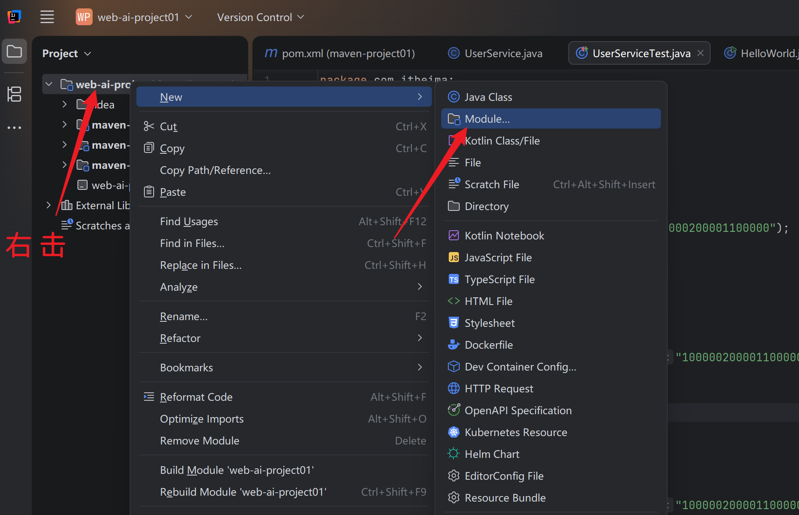
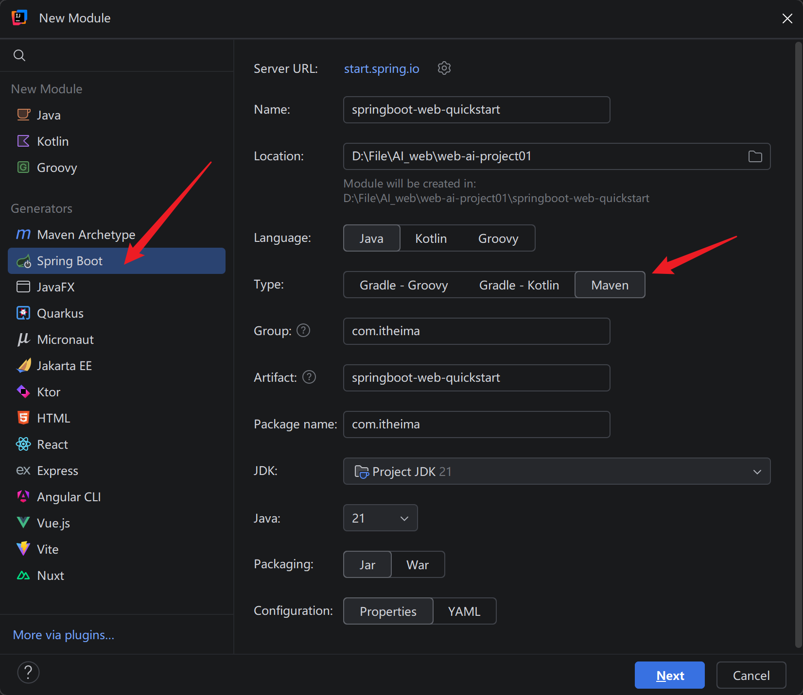
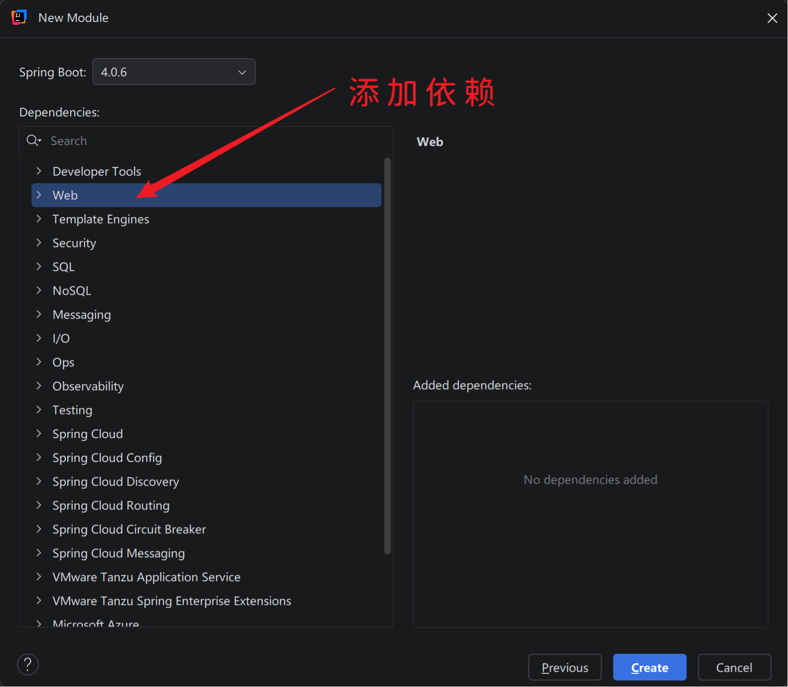
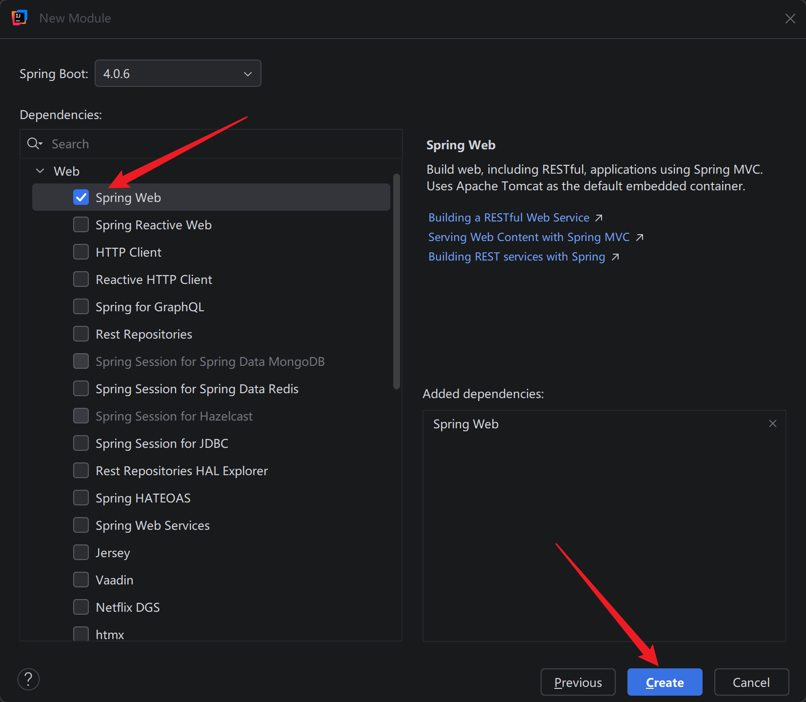
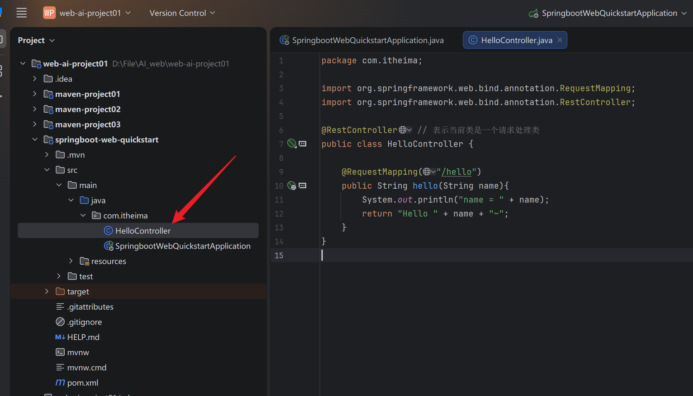
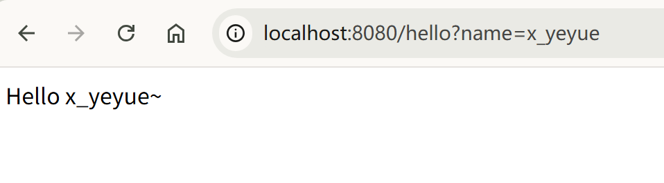

## 导入 SpringBoot 模块









## 基础例子

**需求:**


浏览器向服务器的 `hello` 地址发起请求，服务器获取请求中的 `name` 值并按照图中格式输出，并返回给浏览器。

**实现:**



在如图目录中创建 `HelloController` 类文件，并实现如图代码。

在 `SpringbootWebQuickstartApplication` 中运行后，实现该效果。如图:



## 获取请求参数

`/dept?id=14`

### HttpServletRequest

```java
/**
 * 第一种方式 HttpServletRequest
 */
@DeleteMapping("/depts")
public Result delete(HttpServletRequest request){
	String idStr = request.getParameter("id");
	int id = Integer.parseInt(idStr);
	System.out.println("根据 ID 删除部门: " + id);
	return Result.success();
}
```

### @RequestParam

```java
/**
 * 第二种方式 @RequestParam
 * 注: 一旦设置了 @RequestParam 注解，则指定参数必须传递，否则会报错。(默认 required = true)
 */
@DeleteMapping("/depts")
public Result delete(@RequestParam(value = "id", required = false) Integer deptId){
	System.out.println("根据 ID 删除部门: " + deptId);
	return Result.success();
}
```

#### 设置参数默认值

```java
@GetMapping("/emps")
public Result page(@RequestParam(defaultValue = "1") Integer page, @RequestParam(defaultValue = "10") Integer pageSize){
        log.info("分页查询: {}, {}", page, pageSize);
        PageResult<Emp> pageResult = empService.page(page, pageSize);
        return Result.success(pageResult);
    }
```


### 省略 @RequestParam (推荐)

```java
/**
 * 第三种方式，省略 @RequestParam
 * 当请求参数名与形参变量名相同，直接定义方法形参即可
 * /depts?id=15
 */
@DeleteMapping("/depts")
public Result delete(Integer id){
	System.out.println("根据 ID 删除部门: " + id);
	return Result.success();
}
```

### @RequestBody (接收 json 数据)

> 接收 json 格式的请求参数: `POST /depts {"name": "教研室"}`

json 格式的参数，通常会使用一个实体对象进行接收。

**规则**: json 数据的 *键名* 与方法形参 *对象的属性名* 相同，并需要使用 `@RequestBody` 注解标识。

```java
@PostMapping("/depts")
public Result add(@RequestBody Dept dept){
	System.out.println("新增部门: " + dept);
	return Result.success();
}
```

```java
public class Dept {
    private Integer id;
    private String name;
    private LocalDateTime createTime;
    private LocalDateTime updateTime;
}
```

### 获取日期时间

请求路径中的日期格式可能会有很多，例如: `yyyy-MM-dd`、`yyyy/MM/dd`、`yyyy年MM月dd日` 等等。

通过 `@DateTimeFormat` 注解，指定 `pattern` 参数来确定日期格式，该注解会将日期按照该格式解析后传递给后面的参数。

```java
/**
 * 请求路径: /emps?name=张&gender=1&begin=2007-09-01&end=2022-09-01&page=1&pageSize=10
*/
@GetMapping
public Result page(@RequestParam(defaultValue = "1") Integer page,
				   @RequestParam(defaultValue = "10") Integer pageSize,
				   String name,
				   Integer gender,
				   @DateTimeFormat(pattern = "yyyy-MM-dd") LocalDate begin,
				   @DateTimeFormat(pattern = "yyyy-MM-dd") LocalDate end){
	log.info("分页查询: page-{}, pageSize-{}, name-{}, gender-{}, begin-{}, end-{}", page, pageSize,  name, gender, begin, end);
	PageResult<Emp> pageResult = empService.page(page, pageSize, name, gender, begin, end);
	return Result.success(pageResult);
}
```

### @PathVariable(接收 路径参数)

> 接收路径参数: `GET /depts/1`

路径参数: 通过 URL 直接传递参数，使用 `{...}` 来标识该路径参数，需要使用 `@PathVariable` 获取路径参数。

```java
@GetMapping("/depts/{id}")
public Result getInfo(@PathVariable("id") Integer deptId){
	System.out.println("根据  ID 查询部门: " + deptId);
	return Result.success();
}
```

当路径参数和形参一致时，简略写法:

```java
@GetMapping("/depts/{id}")
public Result getInfo(@PathVariable Integer id){
	System.out.println("根据  ID 查询部门: " + id);
	return Result.success();
}
```

## 接收数组

`/emps?ids=1,2,3`

1. 通过数组接收
   ```java
   @DeleteMapping  
	public Result delete(Integer[] ids){  
	    log.info("根据ID删除员工: {}", ids);  
	    return Result.success();  
	}
   ```
2. 通过集合接收
   ```java
   // 将接收到的参数封装到集合等复杂类型中必须写 @RequestParam 注解
   @DeleteMapping
    public Result delete(@RequestParam List<Integer> ids){
        log.info("根据ID删除员工: {}", ids);
        return Result.success();

    }
   ```

## 请求路径简化

当请求路径中有公共前缀时，可以在类前通过 `@RequestMapping` 注解标注公共部分。

原:

```java
@RestController
public class DeptController {

    @Autowired
    private DeptService deptService;

    @GetMapping("/depts")
    public Result list(){
        System.out.println("查询全部的部门数据");
        List<Dept> deptList = deptService.findAll();
        return Result.success(deptList);
    }

    @DeleteMapping("/depts")
    public Result delete(Integer id){
        System.out.println("根据 ID 删除部门: " + id);
        deptService.deleteById(id);
        return Result.success();
    }

    @PostMapping("/depts")
    public Result add(@RequestBody Dept dept){
        System.out.println("新增部门: " + dept);
        deptService.add(dept);
        return Result.success();
    }

    @GetMapping("/depts/{id}")
    public Result getInfo(@PathVariable Integer id){
        System.out.println("根据  ID 查询部门: " + id);
        Dept dept = deptService.getById(id);
        return Result.success(dept);
    }

    @PutMapping("/depts")
    public Result update(@RequestBody Dept dept){
        System.out.println("根据 id 更新部门信息: " + dept);
        deptService.update(dept);
        return Result.success();
    }
}
```

简化:

```java
@RequestMapping("/depts")
@RestController
public class DeptController {

    @Autowired
    private DeptService deptService;

    @GetMapping
    public Result list(){
        System.out.println("查询全部的部门数据");
        List<Dept> deptList = deptService.findAll();
        return Result.success(deptList);
    }

    @DeleteMapping
    public Result delete(Integer id){
        System.out.println("根据 ID 删除部门: " + id);
        deptService.deleteById(id);
        return Result.success();
    }

    @PostMapping
    public Result add(@RequestBody Dept dept){
        System.out.println("新增部门: " + dept);
        deptService.add(dept);
        return Result.success();
    }

    @GetMapping("/{id}")
    public Result getInfo(@PathVariable Integer id){
        System.out.println("根据  ID 查询部门: " + id);
        Dept dept = deptService.getById(id);
        return Result.success(dept);
    }

    @PutMapping
    public Result update(@RequestBody Dept dept){
        System.out.println("根据 id 更新部门信息: " + dept);
        deptService.update(dept);
        return Result.success();
    }
}
```

# 分页查询

## 原始方案

```java
// =============== Mapper 层 ===============

/**
 * 查询总记录数
 */
@Select("Select count(*) from emp ...")
public Long count();

/**
 * 分页查询
 */
@Select("Select emp.*, dept.name deptName from emp ... limit #{start}, #{pageSize} ")
public List<Emp> list(Integer start, Integer pageSize);

// =============== Service 层 ===============

public PageResult<Emp> page(Integer page, Integer pageSize) {
	log.info("获取 PageResult.");
	Integer start = (page - 1) * pageSize;
	Long total = empMapper.count(); 
	log.info("用户信息条数: {}", total);
	List<Emp> empList = empMapper.list(start, pageSize);
	return new PageResult<Emp> (total, empList);
}
```

## PageHelper 插件

![[PageHelper]]

## 条件分页查询

### 基本实现

请求参数: `emps?name=阮&gender=1&begin=2007-09-01&end=2022-09-01&page=1&pageSize=10`

controller层:

```java
public Result page(@RequestParam(defaultValue = "1") Integer page,
                       @RequestParam(defaultValue = "10") Integer pageSize,
                       String name,
                       Integer gender,
                       @DateTimeFormat(pattern = "yyyy-MM-dd") LocalDate begin,
                       @DateTimeFormat(pattern = "yyyy-MM-dd") LocalDate end){
        log.info("分页查询: page-{}, pageSize-{}, name-{}, gender-{}, begin-{}, end-{}", page, pageSize,  name, gender, begin, end);
        PageResult<Emp> pageResult = empService.page(page, pageSize, name, gender, begin, end);
        return Result.success(pageResult);
    }
```

- `@DateTimeFormat()` 注解参考 [获取日期时间](#获取日期时间)。

service 层及 mapper 层见 [多参数查询](PageHelper.md#多参数查询) 部分的图片。

SQL 代码:

```sql
select emp.*, dept.name from emp left join dept on emp.dept_id = dept.id
	where
		emp.name like concat('%', #{name}, '%') and
		emp.gender = #{gender} and
		emp.entry_date
	between #{begin} and #{end}
	order by emp.update_time desc
```

`concat()` 函数参考 [MySQL字符串拼接](../class/mysql/mysql_基础操作.md#字符串拼接) 。

如果直接使用 `emp.name like '%#{name}%'` 替换 `concat()` 函数，在编译后，会形成 `emp.name like '%?%'`，由于外部的引号，该位置的就会变成一个字符串，就会导致参数无法传递，从而报错。

### 程序优化

#### 请求参数接收优化

如果 controller 方法的 *参数较多* ，且未来可能继续增加，这会使得方法签名变得复杂难以维护，此时可以考虑将多个请求参数 **封装为一个对象**。

```java
@Data
public class EmpQueryParam {
    private Integer page = 1; // 当前页码
    private Integer pageSize = 10; // 每页记录数
    private String name; // 员工姓名
    private Integer gender; // 员工性别
    @DateTimeFormat(pattern = "yyyy-MM-dd")
    private LocalDate begin; // 查询入职日期起始时间
    @DateTimeFormat(pattern = "yyyy-MM-dd")
    private LocalDate end; // 入职日期日期结束时间
}
```

```java
// ================== controller ==================
@GetMapping  
public Result page(EmpQueryParam empQueryParam) {  
    log.info("分页查询: {}", empQueryParam);  
    PageResult<Emp> pageResult = empService.page(empQueryParam);  
    return Result.success(pageResult);  
}

// ================== service ==================
public PageResult<Emp> page(EmpQueryParam empQueryParam) {  
    // 设置分页参数  
    PageHelper.startPage(empQueryParam.getPage(), empQueryParam.getPageSize());  
    // 调用 Mapper 接口方法  
    List<Emp> empList = empMapper.list(empQueryParam);  
    // 解析并封装结果  
    Page<Emp> p = (Page<Emp>) empList;  
    return new PageResult<Emp>(p.getTotal(), p.getResult());  
}

// ================== mapper ==================
public List<Emp> list(EmpQueryParam empQueryParam);
```

**注:** mapper层使用了 [XML 映射配置(SQL)](Mybatis.md#XML%20映射配置(SQL))。

```sql
select emp.*, dept.name from emp left join dept on emp.dept_id = dept.id  
    where        
	    emp.name like concat('%', #{name}, '%') and        
	    emp.gender = #{gender} and        
	    emp.entry_date between #{begin} and #{end}    
	order by emp.update_time desc
```

#### 动态 SQL 优化

当有多个传递参数时，可能有部分传递参数为 `null` 即为传递，当 SQL 被写死，就会出现报错，通过 Mybatis 的 [动态 SQL](Mybatis.md#动态%20SQL) 进行优化，就能解决传递参数缺失造成的报错问题。

```xml
<select id = "list" resultType = "com.itheima.pojo.Emp">  
    select emp.*, dept.name from emp left join dept on emp.dept_id = dept.id  
        <where>  
            <if test="name != null and name != ''">  
                emp.name like concat('%', #{name}, '%')  
            </if>  
            <if test="gender != null">  
                and emp.gender = #{gender}  
            </if>  
            <if test="begin != null  and end != null">  
                and emp.entry_date between #{begin} and #{end}  
            </if>  
        </where>  
        order by emp.update_time desc  
</select>
```

# 启用数据库自动产生的主键

当有些表的主键设置了*自增*属性，那么在插入新的记录的时候就需要尽量避开为这个字段赋值。

那么如果在插入记录后，就要利用这个新增 记录的主键呢？

选择用单独的查询语句来查询吗？

可以利用 Mybatis 的设置快速获取。

## 注解映射

   ```java
   @Options(useGeneratedKeys = true, keyProperty = "id")
   @Insert("insert into ......")
   void insert(Emp emp);
   ```

## XML 映射

   ```java
   void insert(Emp emp);
   
   
   ------------ xml ------------
    <insert id="insert" useGeneratedKeys="true" keyProperty="id">  
	    insert into ......
	</insert>
   ```

# 事务管理

## 通过注解操作

概念见 [事务管理](../class/mysql/mysql_基础操作.md#事务管理)。

- 注解: `@Transactional`
- 作用: 将当前方法交给 spring 进行事务管理，方法执行前，开启事务；成功执行完毕、提交事务；出现异常，回滚事务。
- 位置: 业务层(service) 的方法上、类上、接口上。

```java
@Transactional  
@Override  
public void save(Emp emp) {  
    // 保存员工基本信息  
    emp.setCreateTime(LocalDateTime.now());  
    emp.setUpdateTime(LocalDateTime.now());  
    empMapper.insert(emp);  
  
    // 保存员工工作经历信息  
    List<EmpExpr> exprList = emp.getExprList();  
    if(!exprList.isEmpty()){  
        // 遍历集合，为每项 empExpr 的 empId 赋值  
        exprList.forEach(empExpr -> {  
            empExpr.setEmpId(emp.getId());  
        });  
  
        empExprMapper.insertBatch(exprList);  
    }  
}
```

> [!tips]
> 推荐将 `@Transactional` 注解放在有多个数据库操作的方法上。

## 设置事务管理的日志信息

```yml
# 配置事务管理日志级别  
logging:  
  level:  
    org.springframework.jdbc.support.JdbcTransactionManager: debug
```


## 事务进阶

### 控制回滚事务类型 rollbackFor

`@Transactional` 的 `rollbackFor` 属性用于控制出现何种异常类型，回滚事务。

```java
@Transactional(rollbackFor = {Exception.class}) // 所有异常都回滚
@Override  
public void save(Emp emp) {  
    // 保存员工基本信息  
    emp.setCreateTime(LocalDateTime.now());  
    emp.setUpdateTime(LocalDateTime.now());  
    empMapper.insert(emp);  
  
    // 保存员工工作经历信息  
    List<EmpExpr> exprList = emp.getExprList();  
    if(!exprList.isEmpty()){  
        // 遍历集合，为每项 empExpr 的 empId 赋值  
        exprList.forEach(empExpr -> {  
            empExpr.setEmpId(emp.getId());  
        });  
  
        empExprMapper.insertBatch(exprList);  
    }  
}
```

> [!tips]
> 默认情况下仅会在出现 运行时异常 `RuntimeException` 事务才会回滚。

### 事务的传播行为 propagation

`propagation` 属性用于设置事务传播行为: 当一个事务方法被另一个事务方法调用时，这个事务方法应该如何进行事务控制。

```java
@Transacational
public void a(){
	// ...
	userService.b();
	// ...
}

------

@Transacational(propagation = Propagation.REQUIRED)
public void b(){
	// ...
}
```

|      属性值      |                含义                 |
| :-----------: | :-------------------------------: |
|   REQUIRED    |      \[默认值]需要事务，有则加入，无则创建新事物      |
| REQUIRES_NEW  |        需要新事务，无论有无，总是创建新事务         |
|   SUPPORTS    |       支持事务，有则加入，无则在无事务状态运行        |
| NOT_SUPPORTED | 不支持事务，在无事务状态运行，如果当前存在已有事务，则挂起当前事务 |
|   MANDATORY   |            必须有事务，否则抛异常            |
|     NEVER     |            必须没事务，否则抛异常            |

#### 样例

需求: 在新增员工信息时，无论是成功还是失败，都要记录操作日志。

```java
// ============== EmpServiceImpl ==============
@Transactional(rollbackFor = {Exception.class}) // 事务管理(设置所有异常都回滚)  
@Override  
public void save(Emp emp) throws Exception {  
    try {  
        // 保存员工基本信息  
        emp.setCreateTime(LocalDateTime.now());  
        emp.setUpdateTime(LocalDateTime.now());  
        empMapper.insert(emp);  
  
        Integer i = 1/0;  
        
        List<EmpExpr> exprList = emp.getExprList();  
        if(!exprList.isEmpty()){  
            // 遍历集合，为每项 empExpr 的 empId 赋值  
            exprList.forEach(empExpr -> {  
                empExpr.setEmpId(emp.getId());  
            });  
  
            empExprMapper.insertBatch(exprList);  
        }  
    } finally {  // 记录操作日志
        EmpLog empLog = new EmpLog(null, LocalDateTime.now(), "新增员工: " + emp);  
        empLogService.insertLog(empLog);
    }  
}

// ============== EmpLogServiceImpl ==============
@Override  
public void insertLog(EmpLog empLog) {  
    empLogMapper.insert(empLog);  
}
```

当调用后，由于 `i / 0` 发生了错误，即使将记录操作日志的行为放到了 `finally` 块中，其代码的确执行了，但由于该方法发生了错误，最终会被 *事务回滚*，导致操作日志没有成功写入数据库。 

解决方案: 在 `EmpLogServiceImpl` 的 `insertLog` 方法添加事务管理，同时设置 `propagation` 属性为 `REQUIRES_NEW`，在一个新创建的事务中运行。

```java
// ============== EmpServiceImpl ==============
@Transactional(rollbackFor = {Exception.class}) // 事务管理(设置所有异常都回滚)  
@Override  
public void save(Emp emp) throws Exception {  
    try {  
        // 保存员工基本信息  
        emp.setCreateTime(LocalDateTime.now());  
        emp.setUpdateTime(LocalDateTime.now());  
        empMapper.insert(emp);  
  
        Integer i = 1/0;  
        
        List<EmpExpr> exprList = emp.getExprList();  
        if(!exprList.isEmpty()){  
            // 遍历集合，为每项 empExpr 的 empId 赋值  
            exprList.forEach(empExpr -> {  
                empExpr.setEmpId(emp.getId());  
            });  
  
            empExprMapper.insertBatch(exprList);  
        }  
    } finally {  // 记录操作日志
        EmpLog empLog = new EmpLog(null, LocalDateTime.now(), "新增员工: " + emp);  
        empLogService.insertLog(empLog);
    }  
}

// ============== EmpLogServiceImpl ==============
@Transactional(propagation = Propagation.REQUIRES_NEW) // 在新建的事务中运行  
@Override  
public void insertLog(EmpLog empLog) {  
    empLogMapper.insert(empLog);  
}
```


